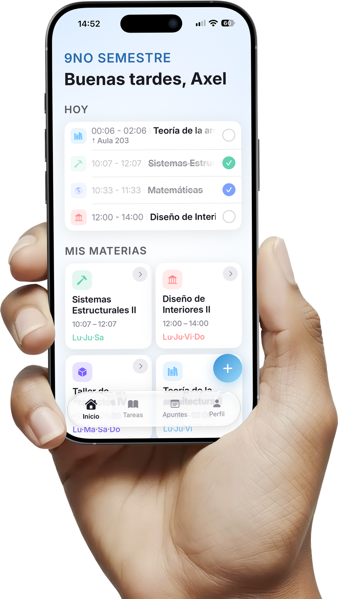
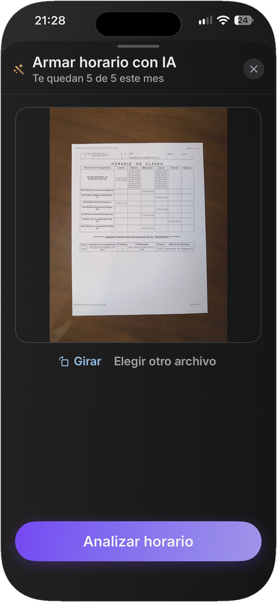
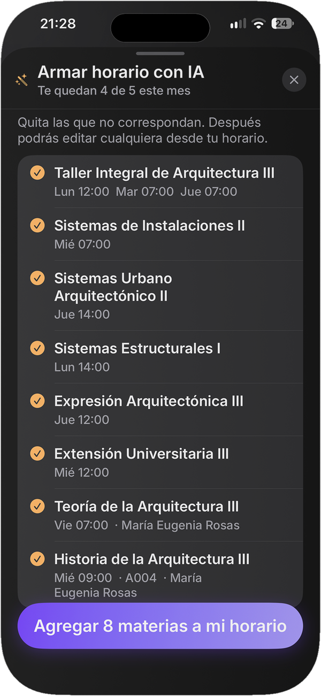
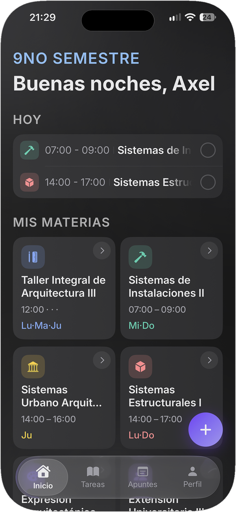
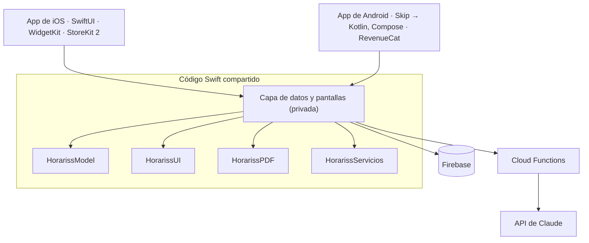

# Horariss

<p align="center">

</p>

App de horario escolar para iPhone y Android. Los estudiantes arman su horario a partir de una foto o del PDF de su escuela, llevan sus tareas con recordatorios y guardan apuntes por materia.

**[App Store](https://apps.apple.com/mx/app/id6787781564)** · **[Caso de estudio en Behance](https://www.behance.net/gallery/258110439/Portafolio-de-Diseno-UXUI-y-Arquitectura)** · *[English](README.md)*

iOS: en la App Store desde julio de 2026 · Android: en prueba cerrada en Google Play

---

## Qué hace

- **Horario desde una foto o un PDF.** Un modelo de visión lee materias, días, horas y salones, y el usuario revisa antes de guardar.
- **Horarios de la vida real.** Hora y salón distintos por día, una misma materia hasta tres veces al día y dos cursos a la vez.
- **Tareas** con recordatorios combinables y consejos de estudio con IA.
- **Apuntes por materia** con fotos y notas de voz transcritas en el propio teléfono (iOS).
- **Avisos de clase, widgets y sincronización con el calendario** (iOS).
- **El horario semanal en PDF**, listo para imprimir.
- **Freemium**, con suscripción mensual y anual.

<p align="center">



</p>
<p align="center"><sub>La foto del horario impreso → lo que leyó la IA, listo para revisar → el horario en la app.</sub></p>

## Tecnologías

| Área | Tecnología |
|---|---|
| Lenguaje e interfaz | Swift 6, SwiftUI, iOS 18+ |
| Android | [Skip](https://skip.tools): traduce el mismo código Swift y SwiftUI a Kotlin y Jetpack Compose |
| Backend | Firebase Authentication (Apple, Google y correo), Cloud Firestore, Cloud Storage, App Check y Analytics |
| Servidor | Cloud Functions en Node.js |
| IA | API de Claude, solo desde el servidor: Sonnet 5 lee horarios con un esquema estricto de herramientas; Haiku 4.5 escribe los consejos de estudio |
| Pagos | StoreKit 2 en iOS; RevenueCat sobre Google Play Billing en Android |
| Plataforma | WidgetKit, EventKit, UserNotifications y AlarmManager, Speech (en el teléfono) y PDF con Core Graphics |
| Pruebas | Swift Testing |

## Arquitectura



Un mismo código se compila dos veces: Xcode lo compila para iOS y Skip lo traduce para Android. La regla que lo hace posible: **nada por debajo de las pantallas importa UIKit**. Lo propio de cada plataforma va dentro de `#if SKIP` / `#if !SKIP`. La clave de la IA nunca viaja en la app: cada llamada al modelo pasa por Cloud Functions, con límites por usuario.

## Cómo está organizado el código

Este repositorio contiene el núcleo compartido de la app real:

```
Sources/
  HorarissModel/       Modelo de datos (materias, bloques de horario, tareas, apuntes). Sin
                       frameworks de interfaz, así que compila para Android sin cambios. Lectura
                       tolerante de datos viejos y de los números de Firestore, que en Android
                       llegan como Long.
  HorarissUI/          Sistema de diseño: tokens, tipografía Inter y colores claros y oscuros
                       desde un catálogo que Skip puede leer.
  HorarissPDF/         Maqueta del PDF semanal como aritmética pura: los carriles de las clases
                       que se empalman se calculan una vez y cada plataforma solo dibuja.
  HorarissServicios/   Servicios de plataforma, cada uno con su versión de iOS y de Android:
                       avisos locales (UserNotifications / AlarmManager), sincronización con el
                       calendario (EventKit) y las cuentas de los planes del paywall.
Tests/                 31 pruebas de los módulos anteriores.
Examples/Widget/       El widget de iOS (WidgetKit). Lee una instantánea que la app escribe en un
                       App Group compartido. Es solo para leerlo; este paquete no lo compila.
```

**No incluye:** la capa de datos y las pantallas, la integración con las tiendas, las Cloud Functions, el proyecto de Android ni las claves y archivos de configuración.

Los comentarios del código están en español, el idioma del proyecto.

## Correr las pruebas

Requiere Xcode 16 o posterior en macOS 14 o posterior.

```bash
swift test
```

## Licencia

© 2026 Omar Said Carpinteiro Tapia. Todos los derechos reservados. Se publica solo para revisión de portafolio; ver [LICENSE](LICENSE).

**Contacto:** omar.said.ct@gmail.com
