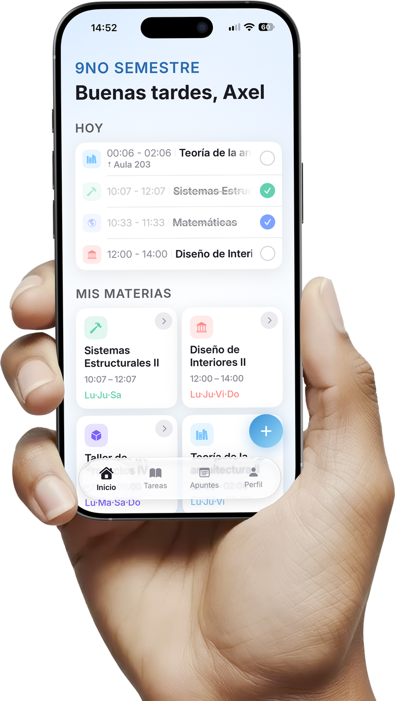
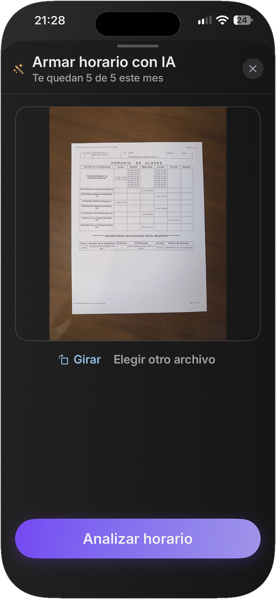
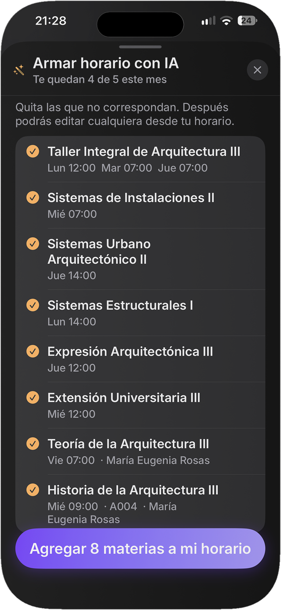
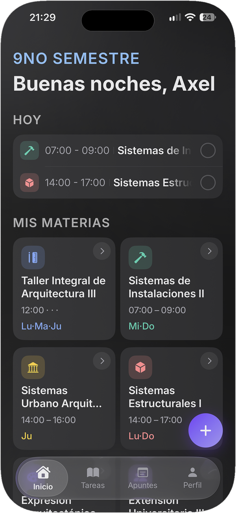
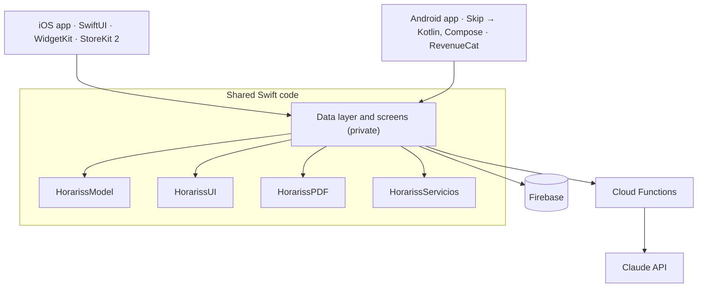

# Horariss

<p align="center">

</p>

School schedule app for iPhone and Android. Students build their timetable from a photo or PDF of it, track assignments with reminders and keep notes per subject.

**[App Store](https://apps.apple.com/mx/app/id6787781564)** · **[Case study on Behance](https://www.behance.net/gallery/258110439/Portafolio-de-Diseno-UXUI-y-Arquitectura)** · *[Español](README.es.md)*

iOS: on the App Store since July 2026 · Android: closed testing on Google Play

---

## What it does

- **Schedule from a photo or PDF.** A vision model reads subjects, days, times and rooms; the user reviews before saving.
- **Real-world timetables.** A different time and room per day, the same subject up to three times a day, and two courses at once.
- **Assignments** with stackable reminders and AI study tips.
- **Notes per subject** with photos and on-device voice transcription (iOS).
- **Class reminders, home-screen widgets and calendar sync** (iOS).
- **A printable weekly PDF.**
- **Freemium,** with monthly and yearly subscriptions.

<p align="center">



</p>
<p align="center"><sub>Photo of the printed schedule → the AI's reading, ready to review → the schedule in the app.</sub></p>

## Tech stack

| Area | Technology |
|---|---|
| Language and UI | Swift 6, SwiftUI, iOS 18+ |
| Android | [Skip](https://skip.tools): transpiles the same Swift and SwiftUI code to Kotlin and Jetpack Compose |
| Backend | Firebase Authentication (Apple, Google, email), Cloud Firestore, Cloud Storage, App Check, Analytics |
| Server | Cloud Functions on Node.js |
| AI | Claude API, server-side only: Sonnet 5 reads schedules through a strict tool schema; Haiku 4.5 writes study tips |
| Payments | StoreKit 2 on iOS; RevenueCat over Google Play Billing on Android |
| Platform | WidgetKit, EventKit, UserNotifications and AlarmManager, Speech (on device), Core Graphics PDF |
| Tests | Swift Testing |

## Architecture



One codebase compiles twice: Xcode builds it for iOS, and Skip transpiles it for Android. The rule that keeps this working: **nothing below the screens imports UIKit**. Platform-specific code lives behind `#if SKIP` / `#if !SKIP`. The AI key never ships in the app: every model call goes through Cloud Functions, with per-user limits.

## How the code is organized

This repository holds the shared core of the real app:

```
Sources/
  HorarissModel/       Data model (subjects, schedule blocks, tasks, notes). No UI frameworks,
                       so it compiles for Android unchanged. Tolerant decoding for old data and
                       for Firestore numbers, which arrive as Long on Android.
  HorarissUI/          Design system: tokens, Inter typography, adaptive light/dark colors
                       from an asset catalog that Skip can read.
  HorarissPDF/         Weekly PDF layout as pure arithmetic: lanes for overlapping classes are
                       computed once; each platform only draws.
  HorarissServicios/   Platform services, with an iOS and an Android implementation each:
                       local notifications (UserNotifications / AlarmManager), calendar sync
                       (EventKit) and subscription plan math for the paywall.
Tests/                 31 tests for the modules above.
Examples/Widget/       The iOS widget (WidgetKit). It reads a snapshot that the app writes to a
                       shared App Group. For reading only, not built by this package.
```

**Not included:** the data layer and screens, the store integration, the Cloud Functions, the Android project, and all keys and configuration files.

Code comments are in Spanish, the language of the project.

## Run the tests

Requires Xcode 16 or later on macOS 14 or later.

```bash
swift test
```

## License

© 2026 Omar Said Carpinteiro Tapia. All rights reserved. Published for portfolio review only; see [LICENSE](LICENSE).

**Contact:** omar.said.ct@gmail.com
